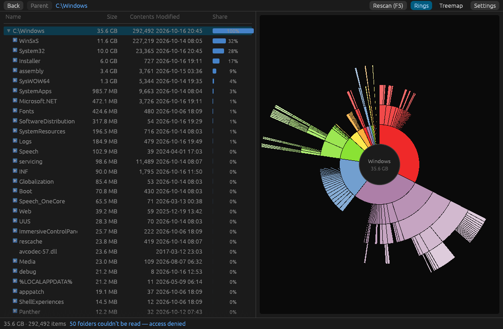
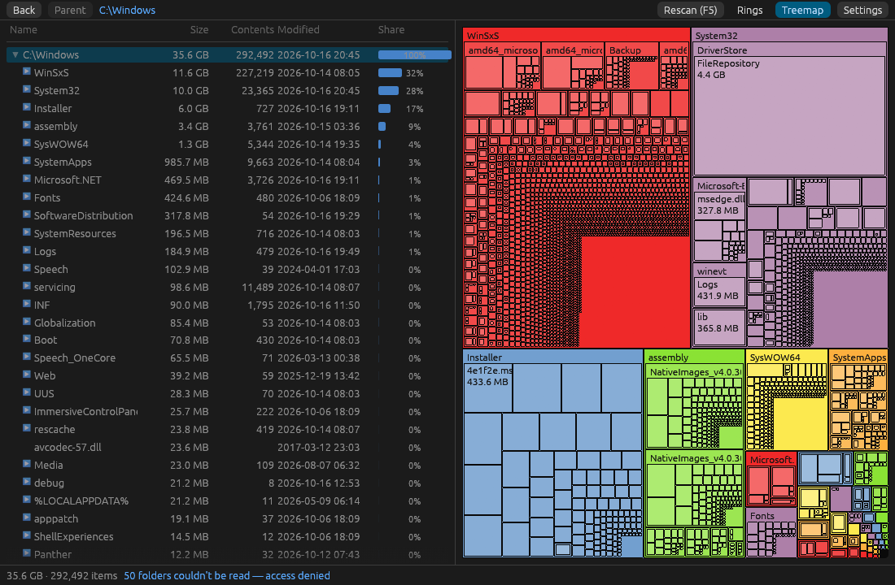
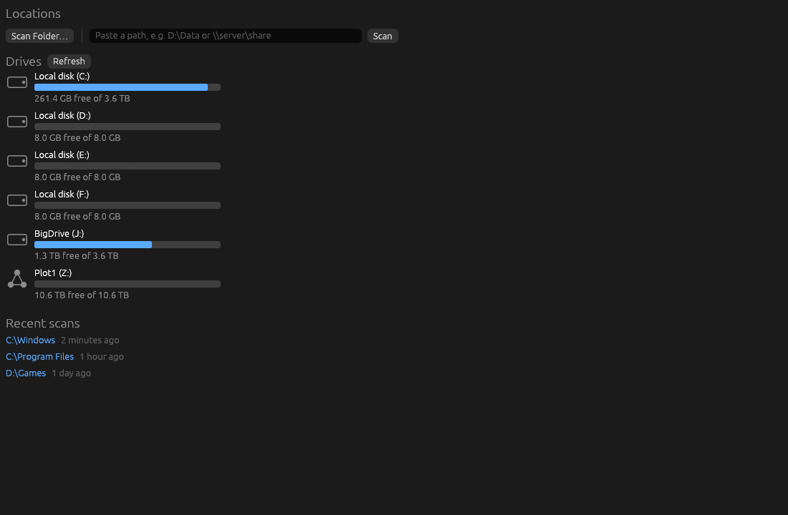

# WinBaobab

A disk usage analyzer for Windows: point it at any drive, folder or network share and see at a glance what is eating the space, drawn as rings or as blocks.



## Download

Get the latest version from the [Releases page](https://github.com/Tomcatt/WinBaobab/releases):

- **`WinBaobab-Setup-x.y.z.exe`**: the installer. Download it and double-click to run it. It installs for your user only (no administrator prompt) and adds a Start menu entry and an uninstaller.
- **`WinBaobab-x.y.z-portable.exe`**: a single file you can run from anywhere, no install needed.

The installer and the portable file are not code-signed (a signing certificate costs money every year), so Windows SmartScreen shows "Windows protected your PC" the first time you run them. To continue, click **More info**, then **Run anyway**.

The installer has an optional checkbox that adds **Analyze with WinBaobab** to the Explorer right-click menu for folders and drives. On Windows 11 that entry is under **Show more options**.

Requires Windows 10 or 11 (64-bit).

## Features

- Two screens like Baobab: a locations screen, then a results screen with a folder tree on the left and a chart on the right.
- Two charts: **Rings** (a sunburst, one ring per folder level) and **Treemap** (nested blocks, bigger block means bigger folder or file).
- Scans local drives, removable drives, mapped network drives, raw UNC paths (`\\server\share\...`) and any folder you pick or paste.
- Click a ring segment or a block to drill into that folder; click the centre to go up. Right-click for Open in Explorer, Copy path and delete.
- Live progress while scanning, a Cancel button that keeps the partial result, and a window that stays responsive on slow network shares.
- Sizes are size on disk, the same figure Windows shows for the drive. Junctions and symlinks are never followed, and hard-linked files are not counted twice.
- Folders it cannot read are counted and listed, never silently skipped.
- Keyboard: `Delete` recycle, `Shift+Delete` delete permanently, `Backspace` or `Alt+Left` up one level, `F5` rescan, `Ctrl+L` focus the path box.





## Deleting files safely

WinBaobab never deletes anything without asking first.

- **Delete** (or right-click, **Move to Recycle Bin**) moves the item to the Recycle Bin after a confirmation, exactly like deleting in Explorer, so you can restore it. If Windows cannot recycle it, nothing is deleted and you are told so. It never falls back to a permanent delete.
- **Network drives and removable drives have no Recycle Bin**, so Move to Recycle Bin is greyed out there, with a tooltip saying why.
- **Shift+Delete** deletes permanently, skipping the Recycle Bin. It shows a warning first. The warning has a "Don't show this warning again" checkbox, and you can turn it back on under **Settings**, **Warn before permanent delete**. On a network path the warning also points out that recovery depends on your NAS (for example its recycle folder or snapshots).
- Deleting is disabled while a scan is running, and the scan root, drive roots and the Unseen block can never be deleted.

## FAQ

**Why is there an "Unseen (system or no access)" block?**
When you scan the whole of a local fixed drive (not a folder, a USB stick or a network share), WinBaobab compares the space Windows says is used with the total it could add up from the folders it was allowed to read. The difference is shown as an Unseen block. It is usually system data your account cannot open, such as the page file, hibernation file, System Volume Information and restore points. WinBaobab never asks for administrator rights, so those stay unseen.

## Build from source

1. Install Rust with [rustup](https://rustup.rs) (stable toolchain, MSVC target).
2. Build:

   ```powershell
   cargo build --release
   ```

   The program is `target\release\winbaobab.exe`.

3. Optional: build the installer and the portable exe. This needs [Inno Setup 6](https://jrsoftware.org/isinfo.php) and runs the tests first:

   ```powershell
   .\scripts\build-release.ps1
   ```

   The results land in `dist\`. The version number comes from `Cargo.toml` (currently 0.1.0).

## License

WinBaobab is free software, licensed under the GNU General Public License, version 2 or (at your option) any later version. See [COPYING](COPYING).

Inspired by and an unofficial port of GNOME Disk Usage Analyzer (Baobab). Not affiliated with or endorsed by the GNOME Project.
